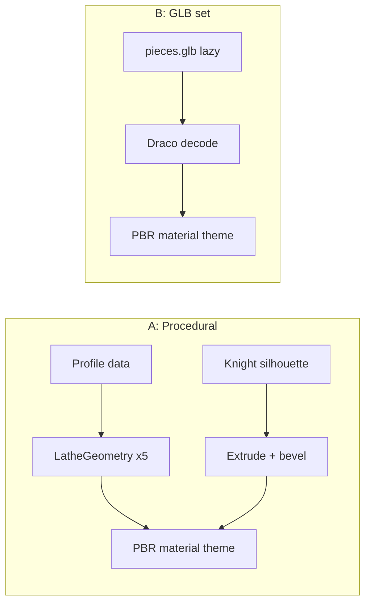
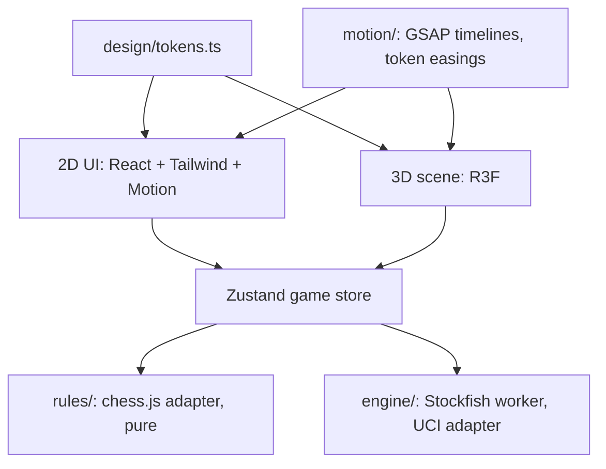

# Plan: Phase 1 — Foundation (setup, design system, 3D board, pieces, legal moves, play vs Stockfish)

> **Request:** Project setup, design system, 3D board, pieces, legal moves, basic play vs Stockfish. Premium, cinematic, tactile look. No placeholder visuals in final work.
> **Depth:** Quick
> **Status:** Implementing. Open: 0. Decided by user: 0. Assumed: 15. Revised: 0.
> **Last updated:** 2026-11-09

## 1. Approach

Three real choices drive Phase 1. The piece-geometry source decides the whole look, so it is D1.

**D1 options (open):**

- **A. Procedural turned pieces + sculpted knight (recommended).** Pawn, rook, bishop, queen, king are lathe profiles (`LatheGeometry`), the way real Staunton pieces are made on a lathe. Profiles are data, so the "morph" in promotion (Phase 2) is a profile tween. Knight is an extruded, beveled silhouette with a carved mane, styled as modern sculpture. Zero download, crisp at any size, full control. Risk: the knight reads "stylized", not "classical".
- **B. CC0 / licensed GLB set.** Classical sculpted look, including a realistic knight. Risk: asset is missing today. You must supply or approve a source and license. Size ~1–4 MB. Promotion morph is harder (mesh-to-mesh dissolve, not a profile tween).
- **C. Hybrid.** A for five pieces, one GLB knight. Classical knight, procedural rest. Risk: style mismatch unless the knight is sculpted to the same profile language.

## 2. Goal and scope

**Goal:** A playable, premium-looking 3D game vs Stockfish that sets the foundations every later phase builds on.

**In scope:**
- Vite + React + TS + Tailwind v4 scaffold, lint, Vitest, git.
- Design tokens (color, type, space, radius, shadow, motion) shared by CSS and the 3D layer.
- 3D board, one material theme, studio lighting, real shadows, subtle bloom.
- Six piece types. Hover lift, legal-move glow, click-to-move and drag-to-move, illegal snap-back.
- Rules via chess.js. Game store via Zustand.
- Stockfish in a Web Worker. Difficulty selector. New game, undo, flip board.
- Promotion picker (2D). Game-over overlay (basic, cinematic version is Phase 2).
- Reduced-motion and quality-tier switches wired (effects themselves grow in later phases).
- Tests: rules integration, engine adapter (UCI parse).

**Out of scope:** per-piece motion signatures, capture/check/mate cinematics (Phase 2). Tactic detection (Phase 3). Academy (Phase 4+). Sound beyond a stub (Phase 2).

**Success measure:** Full game playable to mate/draw vs Stockfish. 60 fps on mid-range laptop at "high" tier. First load under ~300 KB JS gzip before 3D chunk.

## 3. Context from the codebase

New project, no codebase. Node 24.0.2, npm 11.6.0. Current versions checked 2026-11-09: three 0.187, @react-three/fiber 9.8, drei 10.7, postprocessing 3.2, chess.js 1.4, stockfish 19.0, zustand 5.1, gsap 3.15, motion 14.10, tailwindcss 4.3, vite 8.3, howler 2.2.

## 4. Module shape (decision level)

Rules, engine, animation, effects, and UI stay separate. The store holds game truth. The scene only renders it and emits intents (select, move).

## 5. Decision log

| ID | Phase | Question | Choice | Reason | Status | Impact |
|----|-------|----------|--------|--------|--------|--------|
| D1 | 0-1 | Piece geometry source | A. Procedural lathe + sculpted knight | Recommended default; user said "implement" without picking | assumed | high |
| D2 | 0-1 | Default material theme for Phase 1 | Marble + brass | Recommended default | assumed | high |
| D3 | 0-1 | Typography direction | Fraunces + Inter Tight + JetBrains Mono | Recommended default | assumed | high |
| D4 | 0-1 | Stockfish build | Lite single-threaded (1.8 MB) | Recommended default; no special headers | assumed | high |
| D5 | 0-1 | Default color theme at launch | Follow system | Recommended default | assumed | high |
| D6 | 0-1 | Planning depth | Quick | User asked to implement directly | assumed | high |
| A1 | 1 | Animation stack | GSAP for all timelines (3D + 2D sequences); Motion only for React mount/unmount | One easing/duration source for both worlds. react-spring dropped. | assumed | medium |
| A2 | 1 | Tokens | `tokens.ts` is source; generates Tailwind v4 `@theme` CSS vars | 3D layer reads TS, CSS reads vars, no drift | assumed | medium |
| A3 | 1 | Engine wrapper | Typed UCI adapter, one request in flight, cancel on new position | Prevents stale best-moves | assumed | medium |
| A4 | 1 | Difficulty | 6 levels mapping to Stockfish `Skill Level` + `movetime` | Simple, tunable | assumed | low |
| A5 | 1 | Quality tiers | low / medium / high, auto-picked from GPU tier + fps probe, user override | Required by spec | assumed | medium |
| A6 | 1 | Postprocessing | Bloom + SMAA on high; bloom only on medium; none on low. DoF deferred to Phase 2 focus moments | DoF always-on costs fps and blurs play | assumed | medium |
| A7 | 1 | Git | `git init`, commit at phase end | Working rules | assumed | low |
| A8 | 1 | Tests | Vitest for rules + UCI parsing; Playwright smoke later | Fast feedback | assumed | low |
| A9 | 1 | Accessibility | Keyboard square cursor + `aria-live` move announcements from Phase 1 | Cheap now, costly to retrofit | assumed | medium |

## 6. Open decisions

None. D1 to D6 took recommended defaults when the user said "implement". Any can be revised.

## 7. Assumption review

Pending.

## 8. Non-functional needs

| Area | Decision | Status |
|------|----------|--------|
| Performance | 60 fps high tier mid laptop; instanced squares; shadow map 2048 high / 1024 med / off low | assumed |
| Load | 3D scene and Stockfish lazy-loaded; UI shell first | assumed |
| Accessibility | reduced-motion honored; keyboard play; aria-live | assumed |
| Testing | Vitest rules + engine adapter | assumed |
| Rollout | local dev only in Phase 1 | assumed |

## 9. Handoff to implementation

Pending decisions.
