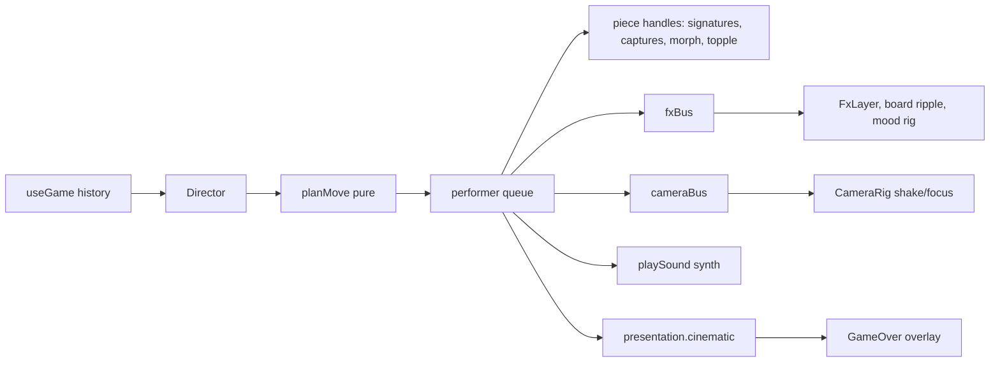

# Plan: Phase 2 — Piece motion, captures, check, checkmate

> **Request:** Unique movement for all six piece types, captures, check, checkmate (plus castling, en passant, promotion).
> **Depth:** Quick. User said "Do it"; decisions below are assumed and revisable.
> **Last updated:** 2026-11-09

## Architecture

A move flows store, then `Director` (derives a `MoveEvent`), then the pure planner `planMove` (a timed `ChoreoPlan` of beats), then the performer (one GSAP timeline per plan, queued FIFO). The performer drives piece handles from a registry and emits to two buses: `fxBus` (effects, lighting mood) and `cameraBus`. Sound plays through `playSound`. `presentation.cinematic` holds UI overlays until the choreography ends.

## Decisions

| ID | Question | Choice | Reason | Status |
|----|----------|--------|--------|--------|
| P1 | Where choreography lives | Pure planner + imperative performer | Testable timing; one place to extend in Phase 3 | assumed |
| P2 | Overlapping moves (fast engine reply) | FIFO queue; backlog plays at 2x | Animations never cut each other | assumed |
| P3 | Sound source | Procedural Web Audio synthesis, no files; Howler dropped | No audio assets exist; no placeholder sounds; zero download | assumed |
| P4 | Capture style per attacker | pawn topple, knight shatter, bishop slice, rook shove, queen dissolve, king dismiss | Spec plus one style per attacker | assumed |
| P5 | Promotion | Lathe profile morph pawn to Q/R/B; crossfade to knight | Profiles are data (Phase 1 D1) | assumed |
| P6 | Checkmate | Slow motion 0.35x near impact, camera dolly to king, king topples, light dims, DoF on high tier; overlay waits | Spec | assumed |
| P7 | Reduced motion | Instant moves, fade captures, no camera/slow motion; keep sound, threat lines, mood | Information stays, motion goes | assumed |
| P8 | Check line | Persists while check holds; one line per checker (double check shows two) | Readable threat; reuses for Phase 3 | assumed |
