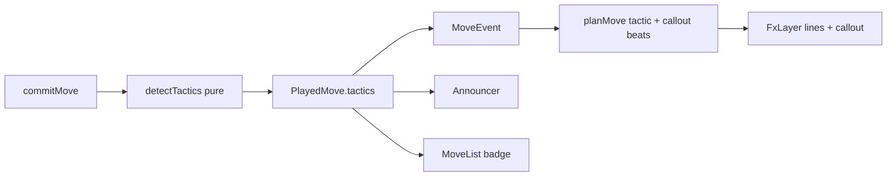

# Plan: Phase 3 — Tactic detection and combo visuals

> **Request:** Detect fork, pin, skewer, discovered attack, double check, sacrifice, back-rank; show each with its own visual and a callout label.
> **Depth:** Quick. User chose "go with recommendation".
> **Last updated:** 2026-11-09

## Architecture

The store calls the pure detector `detectTactics(fenBefore, move)` inside `commitMove` and stores the result on `PlayedMove.tactics`. `toMoveEvent` copies it to `MoveEvent`. `planMove` adds `tactic` (lines) and `callout` (label) fx beats after the move settles. FxLayer draws them; the Announcer and MoveList read `PlayedMove.tactics`.

## Decisions

| ID | Question | Choice | Status |
|----|----------|--------|--------|
| T1 | Whose tactics | Both sides (player and Stockfish); always tactics for the side that moved | user (recommended) |
| T2 | When | Only tactics the last move created; not standing ones | user (recommended) |
| T3 | Sacrifice test | Static exchange evaluation (SEE), offline | user (recommended) |
| T4 | Several at once | Strongest gets the label (TACTIC_PRIORITY); others draw dimmer lines; settings toggle | user (recommended) |
| T5 | Sacrifice vs blunder | Label a sacrifice only when the move also gives check or creates another tactic | assumed |
| T6 | On checkmate | Mate cinematic owns the stage; tactic lines and callout are skipped except back-rank mate label | assumed |
| T7 | Reduced motion | Lines and callout still show (information); no motion, short fades | assumed |
| T8 | Persistence | Lines bright on reveal, then dim; end at next move (like the check line) | assumed |
